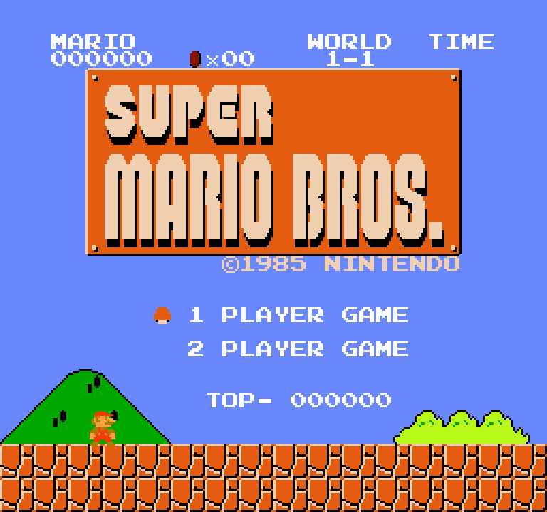
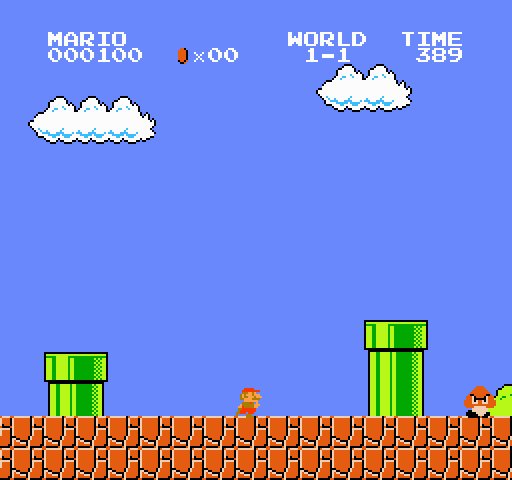
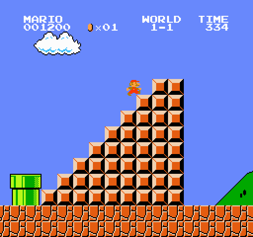
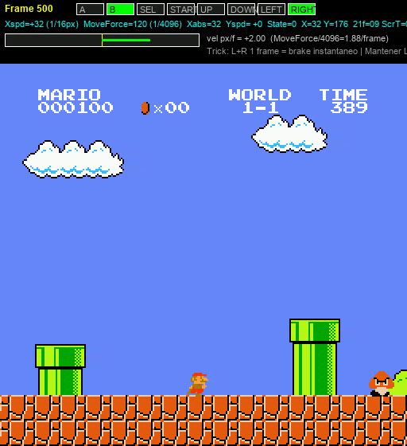
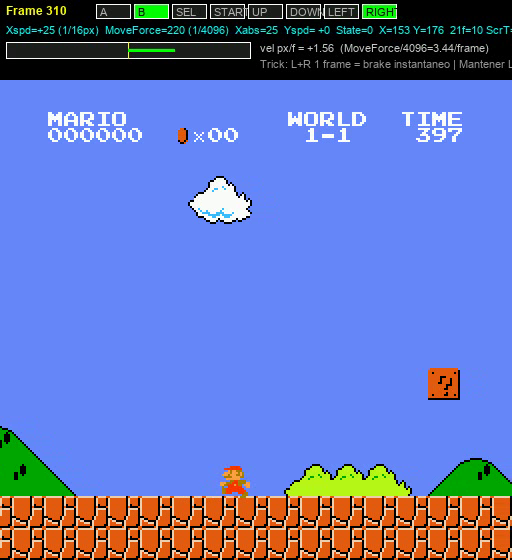
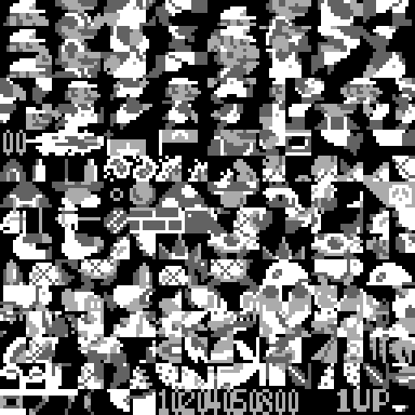
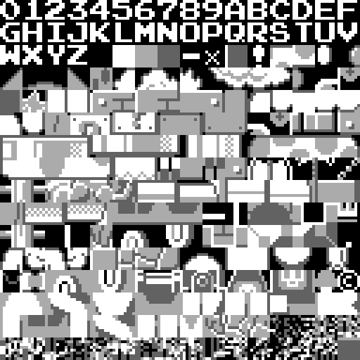
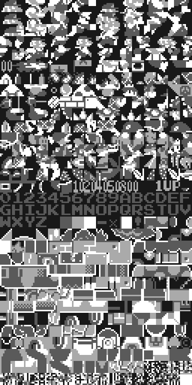

# smb-rs — NES Emulator + Super Mario Bros. RE + AI

> [Español](README.md) | **English** (this file)

NES emulator written from scratch in Rust to **run and reverse-engineer the original Super Mario Bros. (World) ROM**. Not a level clone: the game runs instruction-by-instruction on an emulated 6502 CPU and 2C02 PPU.

Includes:

- **Static ROM analysis** and bug/glitch/trick catalog with ROM/RAM addresses: [`analysis/BUGS_Y_TRUCOS.md`](analysis/BUGS_Y_TRUCOS.md) (Spanish) / [`analysis/BUGS_Y_TRUCOS.en.md`](analysis/BUGS_Y_TRUCOS.en.md)
- **Publication audit** (what's already on TASVideos/speedrun.com vs. what's new): [`analysis/TRUCOS_PUBLICADOS.md`](analysis/TRUCOS_PUBLICADOS.md) / [`analysis/TRUCOS_PUBLICADOS.en.md`](analysis/TRUCOS_PUBLICADOS.en.md)
- **Neuroevolution AI** that learns 1-1 on the real ROM: `120 → 48 → 7` network (6151 parameters), instant snapshot, frame-skipping and speed fitness. See [§ AI](#ai--neural-network-train--watchall) and [`ai/README.md`](ai/README.md) / [`ai/README.es.md`](ai/README.es.md)
- **Speed + input HUD videos** (generated with the emulator, not YouTube captures).

---

## 🎬 Demos

### Full 1-1 showcase video with TAS tricks — 35s

<video src="assets/videos/showcase_completo_1-1.mp4" controls width="640"></video>

**[▶ Open `assets/videos/showcase_completo_1-1.mp4` (21.9 MB, 2093 frames, 60.0988 fps, 512×560)](assets/videos/showcase_completo_1-1.mp4)**

Full 1-1 run (flagpole f1873, victory f2092) executing:

- **DoubleFriction_Turnaround** (f303): `L+B` turn + `L+R+B` 1f — instant brake 40→24 (`$B57F`, `FrictionData $B447`)
- **LR_Moonwalk_Pulse** (f486): `L+R+B` pulse — facing/walk lock
- **Ballistic low jumps** on every pipe/pit/enemy/stair (sensor `$0500` + `Player_X_Speed $0057`)
- Flagpole touch `x=3157 → 3161, score_idx=3, frame_rule=1`

Overlay: inputs (green=pressed) + `Xspd (1/16px) MoveForce (1/4096) Yspd State X/Y 21f($077F)` + speed gauge.

### L+R brake (short version, 8s)

<video src="assets/videos/lr_brake_8s.mp4" controls width="640"></video>

**[▶ Open `assets/videos/lr_brake_8s.mp4` (3.7 MB)](assets/videos/lr_brake_8s.mp4)**

> ⚠️ Old version (stuck on the pipe). Use the one above.

---

## 📸 Screenshots

| 1-1 start | Mid-level (pipes) | Stairs + flagpole | Speed overlay |
|---|---|---|---|
|  |  |  |  |

| Brake overlay (Xspd 40→24) | Pattern table BG | Pattern table SPR | CHR atlas |
|---|---|---|---|
|  |  |  |  |

All screenshots are from the `smb-rs` emulator (×2 scale). Technical prose with bytes and `tricks_audit.log` are in the analysis report.

---

## 🚀 Quick start

```powershell
cargo build --release
.\target\release\smb-rs.exe ".\Super Mario Bros. (World).nes" 3
```

| Key | NES button |
|---|---|
| Arrows | D-pad |
| X | A (jump) |
| Z | B (run) |
| Enter | Start |
| R | Reset |

### Window mode (minifb frontend + cpal audio)

```powershell
.\target\release\smb-rs.exe "C:\Users\USUARIO\Downloads\Super Mario Bros. (World)\Super Mario Bros. (World).nes"
.\target\release\smb-rs.exe "ROM.nes" 3   # x3 scale
```

---

## 🖥️ Emulator — status

| Area | Status |
|---|---|
| 6502 CPU | Complete (legal opcodes). `nestest`: 5260 steps, 0 divergences |
| 2C02 PPU | Background + sprites, fine loopy scroll, sprite-0 hit (scanline 25), NMI, FCEUX/NESdev palettes |
| APU | 5 channels, frame sequencer, optional `cpal` mixing |
| Mapper | NROM (mapper 0), vertical mirroring |
| Game | Title, HUD, playable 1-1, scrolling, enemies, timer, death/restart |

Clean 1-1 frame 500 (no nametable anomaly rows 4-7):


---

## 🎮 Harnesses

### `nesdump` — headless, per-frame inputs, PNG

```powershell
.\target\release\nesdump.exe "ROM.nes" out --frames 500 --scale 2 --script "60:start:1,64:start:0"
.\target\release\nesdump.exe "ROM.nes" out --frames 500 --state
.\target\release\nesdump.exe testroms\nestest.nes out --nestest 5260
```

`--script` format: `frame:button:value,...` (`a,b,select,start,up,down,left,right`). E.g. Right+B f100→150: `100:right:1,100:b:1,150:right:0,150:b:0`.

### `playbot` — TAS heuristic + RAM trick injector

Heart of the videos above. Generates `frame_*.png + telemetry.csv + replay_script.txt + tricks_audit.log`.

```powershell
# Showcase (Double Friction + Moonwalk + Flagpole + low jumps)
.\target\release\playbot.exe "ROM.nes" out_showcase --frames 5000 --scale 2 --trick showcase
.\target\release\playbot.exe "ROM.nes" out --frames 3000 --scale 2 --trick double-friction
.\target\release\playbot.exe "ROM.nes" out --frames 3000 --scale 2 --trick fpg --fpg-x 3036
.\target\release\playbot.exe "ROM.nes" out --frames 2500 --scale 2 --trick minus
.\target\release\playbot.exe "ROM.nes" out_custom --frames 1700 --scale 2 --trick speedrun `
  --macro "name=MyTrick@x=415..420@sub=120..255:SEQ(3:L+B,1:L+R+B,11:R+B+A);name=MyFlag@x=3035..3039@fr=0..10:SEQ(14:R+B+A,25:R+B)"
```

Diagnose in `out/tricks_audit.log` (frame, hex nibble `$06..$09`, subpixel `$0705`, 21-frame rule `$077F`, flag touch) and `out/replay_script.txt` (`frame:btn:val` for `nesdump --script`).

### `videodump` + `make_video.py` — HUD video

```powershell
.\target\release\videodump.exe "ROM.nes" out --frames 500 --scale 2 --script "60:start:1,64:start:0,220:right:1,220:b:1"
python tools\make_video.py out out/trick.mp4
```

### `deepscan` — deep route scanner (map + plan + beam)

Maps 1-1 from the Block Buffer (`$0500`), plans jumps with the ROM physics and searches for a fast route with **real emulator rollouts**. Full guide: [`analysis/DEEPSCAN.en.md`](analysis/DEEPSCAN.en.md).

```powershell
# Snapshot determinism
.\target\release\deepscan.exe "ROM.nes" out_deep --mode selftest

# Full map + heuristic plan
.\target\release\deepscan.exe "ROM.nes" out_deep --mode map --frames 4000
.\target\release\deepscan.exe "ROM.nes" out_deep --mode plan

# Global search (beam search over snapshots) — 1-1 in 1266 frames (21.07 s)
.\target\release\deepscan.exe "ROM.nes" out_deep --mode global --beam 8 --frames 1800 --stride 8 --max-rollout 40 --time-weight 2.5

# Empirical trick probes (reverse acceleration, low gravity, reverse friction)
.\target\release\deepscan.exe "ROM.nes" out_deep --mode probe
```

Outputs: `level_map.json/svg/txt`, `route_plan.json/md/svg`, `route.json`, `route_script.txt` (replayable with `nesdump --script`), `route_trace.csv`, `route_telemetry.csv`, `deepscan_report.md`, `trick_probe.md` and `trick_report.md`.

To **watch it as a video**, `playbot` can replay that exact route:

```powershell
.\target\release\playbot.exe "ROM.nes" out_deepscan_21s --script analysis\deepscan\route_script.txt --scale 2
python tools\make_video.py out_deepscan_21s assets\videos\deepscan_1266f_21s.mp4
```

<video src="assets/videos/deepscan_1266f_21s.mp4" controls width="640"></video>

**[▶ Open `assets/videos/deepscan_1266f_21s.mp4` (17.5 MB, 1725 frames, 60.0988 fps, 512×560)](assets/videos/deepscan_1266f_21s.mp4)**

---

## 🤖 AI — neural network `train` / `watchall`

High-performance neuroevolution trainer on the real ROM (`src/bin/train.rs`, ~1200 lines). Environment `smb_rs::Console`, no level clone.

### Architecture

| Layer | Dim | Notes |
|---|---|---|
| Inputs (sensors) | **120** | Pos/vel (`$57,$9F`), ground (`$1D`), enemies (`$000F` slots), 4×10 Block Buffer grid (`$0500`), wall (distance+height), pit (distance+width), score/coins/timer BCD |
| Hidden | **48** | ReLU (Gauss/Cauchy init, `smart_prior` run/jump bias) |
| Outputs (actions) | **7** | `0, R, R+A, R+B, R+A+B, A, L` → NES bits |
| Parameters | **6151** | `120·48+48 + 48·7+7`. JSON `best_*.json` flat array |

`watchall` uses same 120→48→7 parity, 2D multicell window with HUD (progress, record, victories, fitness, gold border on leader), RAM Snapshot restart, hot-reload every 1s, `[R]` sync race, `[Tab]` turbo 1×/2×/4×, `[M]` rounds, `[Space]` pause.

Colab variant `GRRN-v5` (`watchall.rs`): `159 → 128 → 128 → 39` (recurrent memory 32) — `NW_V5` constant ready for Colab models.

### Training

```powershell
cargo run --release --bin train -- train --gens 300 --pop 64 --skip 4 --seed-file ai\models\best_real.json --out ai\models\best_ai.json
cargo run --release --bin train -- eval --weights ai\models\best_ai.json
cargo run --release --bin train -- watch --weights ai\models\best_ai.json
cargo run --release --bin watchall -- --weights ai\models\best_ai1.json ai\models\best_ai2.json ai\models\best_ai3.json
```

Fitness keys: 1) instant title snapshot, 2) exact sensors (Block Buffer + enemy RAM), 3) ballistic wall/pit prediction, 4) frame-skip + `JUMP_HOLD=26`, 5) effort-vs-time + early stuck cut (150f).

### Models

```
ai/models/ best_real.json (main), best_ai1/2/3.json, best_seed/flag.json, best_gpu.json (GRRN-v5)
ai/README.md / ai/README.es.md — full architecture
```

---

## 🕹️ Tricks — quick guide (buttons)

Full technical report (ROM/RAM) in [`analysis/BUGS_Y_TRUCOS.md`](analysis/BUGS_Y_TRUCOS.md) / [`.en.md`](analysis/BUGS_Y_TRUCOS.en.md). Playable summary:

- **Wrong Warp (4-2):** B+Right, jump pipes, enter **~20px right** of wall, **Down** → unexpected `World X-1`. (`$0750` stale, `HandlePipeEntry $DEE8` reads before `ParseRow0e $C235`, table `$87F2`)
- **Minus World (1-2):** wall before last pipe, **Up+Right** to sit right of wall, **Down** → `World 36-1`. (`$87F2` `$24` unvalidated → world `$23`)
- **Flagpole Glitch (FPG/FFPG):** **B+Right**, jump to pole at full speed, no extra input. FPG skips slide, FFPG skips slide+walk (~3s). Hitbox 4px (`$06-$09`), score `5000/2000/800/400/100` in `$B84B/$B850`.
- **21-frame rule & physics:** `$077F` every **21f (0.35s)**, `ScreenTimer $07A0=7` → **147f/transition**. 8-4 exempt (`HandleAxeMetatile $9384`). Turn doubles friction (`$B57F`); **L+R 1f** brakes 40→24; **subpixel** 1/16px + `MoveForce 1/4096px` decides pole frame.
- **Extended catalog (31 tricks):** `analysis/BUGS_Y_TRUCOS.md` §§13-31 (walljump, vine teleport, pipe clip, wall entry, backwards accel, shooting faster, moustache stomp, moonwalk, fireworks, small fiery Mario, low-gravity, koopa mid-air, 5-sprite limit, whirlpools, trampoline...). Publication status in [`analysis/TRUCOS_PUBLICADOS.md`](analysis/TRUCOS_PUBLICADOS.md).

---

## 🗂️ Repo structure (organized)

```
smb-rs/
├── README.md / README.en.md   ← this file (images + videos + AI)
├── Cargo.toml / Cargo.lock
├── src/ (cpu/ppu/apu/console/cartridge/audio/pngout/lib/main + bin/smb-rs/nesdump/playbot/videodump/train/watchall)
├── analysis/ (BUGS_Y_TRUCOS.md, TRUCOS_PUBLICADOS.md, POST..., disasm, asm, prg/chr)
├── ai/ (README.md, README.es.md, models/, logs/, tmp/)
├── assets/images/ + assets/videos/showcase_completo_1-1.mp4
├── tools/ (analyze.py, make_video.py, find_*.py, debug/)
└── testroms/ (nestest.nes)
```

Historical scripts (`dbg*.py`, etc.) moved to `tools/debug/` and `ai/tmp/` on 2026-11-08.

## 🔍 Verified ROM

| Field | Value |
|---|---|
| File | `Super Mario Bros. (World).nes` |
| Size | 40 976 B |
| CRC32 | `3337EC46` |
| SHA-256 | `f61548fdf1670cffefcc4f0b7bdcdd9eaba0c226e3b74f8666071496988248de` |
| PRG SHA-256 | `5374abb64cfb9b5d961856c60166cedc55859164cf2b8867730e144fa2bdd594` |
| Mapper / mirroring | 0 / vertical |
| Vectors | NMI `$8082`, RESET `$8000`, IRQ `$FFF0` |

## ✅ Validation

- CPU `nestest.nes` 5260 steps, 0 divergences (legal opcodes)
- PPU pattern table from `$2000` (bit4 BG / bit3 SPR), sprite-0 scanline 25, FCEUX palette
- Game captures verified in `out_play/` and `out_showcase/`
- AI `cargo run --release --bin train -- eval --weights ai\models\best_real.json` runs 3000 frames

## ⚠️ Limitations / 📚 References

- Mapper 0 only, no disk save states, audio mix coarse, NTSC-focused (SMB2J/ports not covered except noted).
- Disasm (doppelganger/1wErt3r, pgattic) <https://github.com/pgattic/smb1-disasm>, TASVideos <https://tasvideos.org/GameResources/NES/SuperMarioBros>, Speedrun.com <https://www.speedrun.com/smb1/guides/09v5d>, Negative Seven, Simplistic6502, Data Crystal.
