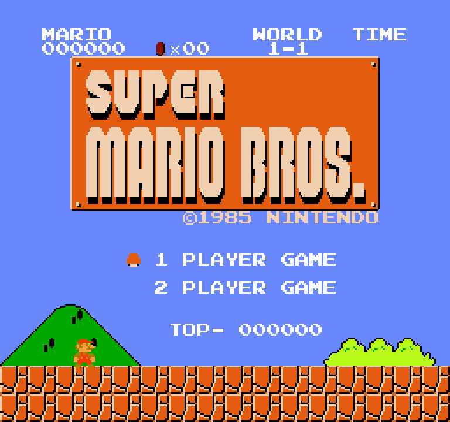
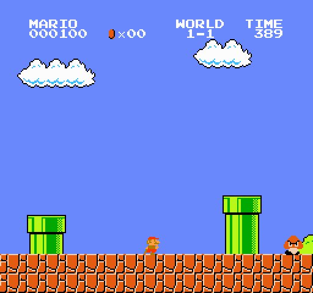
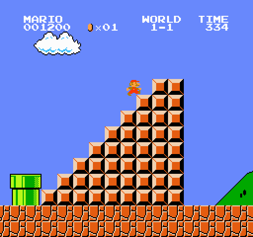
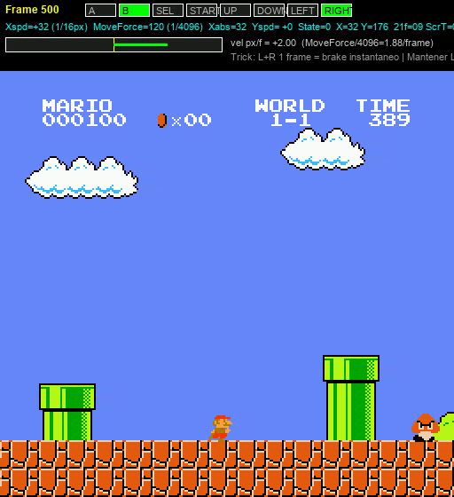
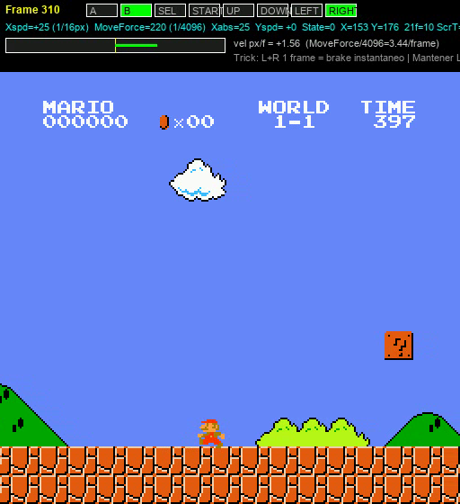
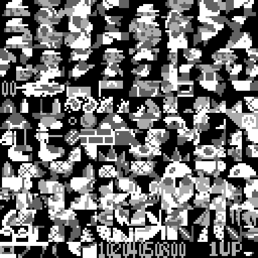
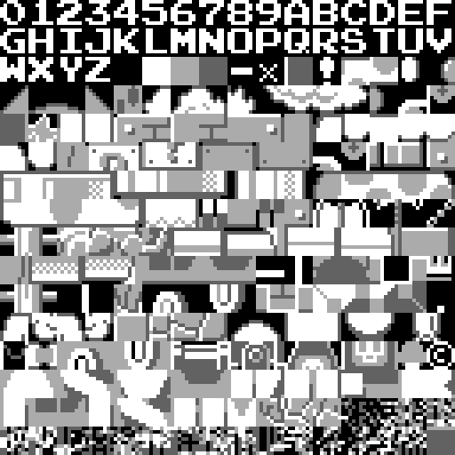
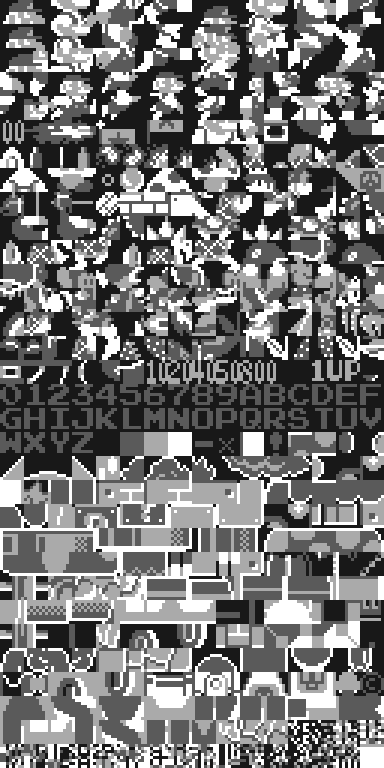

# smb-rs — Emulador NES + Super Mario Bros. RE + IA

> **Español** (este archivo) | [English](README.en.md)

Emulador de NES escrito desde cero en Rust para **ejecutar y reversear la ROM original de Super Mario Bros. (World)**. No es un clon de niveles: el juego corre instrucción por instrucción sobre una CPU 6502 y un PPU 2C02 emulados.

Incluye:

- **Análisis estático de la ROM** y catálogo de bugs/glitches/trucos con direcciones ROM/RAM: [`analysis/BUGS_Y_TRUCOS.md`](analysis/BUGS_Y_TRUCOS.md)
- **Auditoría de publicación** (qué ya está en TASVideos/speedrun.com y qué es nuevo): [`analysis/TRUCOS_PUBLICADOS.md`](analysis/TRUCOS_PUBLICADOS.md) + borrador de foro: [`analysis/POST_SPEEDRUNS_BORRADOR.md`](analysis/POST_SPEEDRUNS_BORRADOR.md)
- **IA neuroevolutiva** que aprende 1-1 sobre la ROM real: red `120 → 48 → 7` (6151 parámetros), snapshot instantáneo, frame-skipping y fitness por velocidad. Ver [§ IA](#ia--red-neuronal-trainwatchall).
- **Vídeos con HUD de velocidad + inputs** (generados con el emulador, no capturas de YouTube).

---

## 🎬 Demos

### Vídeo completo 1-1 con trucos TAS (`showcase`) — 35s

<video src="assets/videos/showcase_completo_1-1.mp4" controls width="640"></video>

**[▶ Abrir `assets/videos/showcase_completo_1-1.mp4` (21.9 MB, 2093 frames, 60.0988 fps, 512×560)](assets/videos/showcase_completo_1-1.mp4)**

Muestra 1-1 completo (flagpole f1873, victoria f2092) ejecutando:

- **DoubleFriction_Turnaround** (f303): giro `L+B` + `L+R+B` 1f — frenada instantánea 40→24 (`$B57F`, `FrictionData $B447`)
- **LR_Moonwalk_Pulse** (f486): pulso `L+R+B` — lock de facing/walk
- **Low jumps balísticos** en cada tubería/pozo/enemigo/escalera (sensor `$0500` + `Player_X_Speed $0057`)
- Llegada al mástil con `x=3157 → 3161, score_idx=3, frame_rule=1`

Overlay: inputs (verde=pulsado) + `Xspd (1/16px) MoveForce (1/4096) Yspd State X/Y 21f($077F)` + gauge de velocidad.

### Brake L+R (versión corta, 8s)

<video src="assets/videos/lr_brake_8s.mp4" controls width="640"></video>

**[▶ Abrir `assets/videos/lr_brake_8s.mp4` (3.7 MB)](assets/videos/lr_brake_8s.mp4)**

> ⚠️ Versión antigua (quedaba en el tubo). La buena es la anterior.

---

## 📸 Capturas

| Inicio 1-1 | Mid-level (tuberías) | Escaleras + flagpole | Overlay velocidad |
|---|---|---|---|
|  |  |  |  |

| Overlay frenada (Xspd 40→24) | Pattern table BG | Pattern table SPR | Atlas CHR |
|---|---|---|---|
|  |  |  |  |

Todas las capturas son del emulador `smb-rs` (escala ×2). La prosa técnica con bytes y el `tricks_audit.log` están en el informe de análisis.

---

## 🚀 Quick start

```powershell
cargo build --release
.\target\release\smb-rs.exe ".\Super Mario Bros. (World).nes" 3
```

| Tecla | Botón NES |
|---|---|
| Flechas | D-pad |
| X | A (salto) |
| Z | B (correr) |
| Enter | Start |
| R | Reset |

### Modo ventana (frontend minifb + audio cpal)

```powershell
.\target\release\smb-rs.exe "C:\Users\USUARIO\Downloads\Super Mario Bros. (World)\Super Mario Bros. (World).nes"
.\target\release\smb-rs.exe "ROM.nes" 3   # escala x3
```

---

## 🖥️ Emulador — estado

| Área | Estado |
|---|---|
| CPU 6502 | Completa (opcodes legales). `nestest`: 5260 pasos, 0 divergencias |
| PPU 2C02 | Fondo + sprites, scroll fino loopy, sprite-0 hit (scanline 25), NMI, paletas FCEUX/NESdev |
| APU | 5 canales, frame sequencer, mezcla `cpal` opcional |
| Mapper | NROM (mapper 0), mirroring vertical |
| Juego | Título, HUD, 1-1 jugable, scroll, enemigos, timer, muerte/reinicio |

Captura frame 500 1-1 (clean, sin anomalía nametable filas 4-7):


---

## 🎮 Harnesses

### `nesdump` — headless, inputs por frame, PNG

```powershell
.\target\release\nesdump.exe "ROM.nes" out --frames 500 --scale 2 --script "60:start:1,64:start:0"
.\target\release\nesdump.exe "ROM.nes" out --frames 500 --state
.\target\release\nesdump.exe testroms\nestest.nes out --nestest 5260
```

Formato `--script`: `frame:boton:valor,...` (`a,b,select,start,up,down,left,right`). Ej. Derecha+B f100→150: `100:right:1,100:b:1,150:right:0,150:b:0`.

### `playbot` — TAS heuristic + inyector de trucos por RAM

El corazón de los vídeos de arriba. Genera `frame_*.png + telemetry.csv + replay_script.txt + tricks_audit.log`.

```powershell
# Showcase (Double Friction + Moonwalk + Flagpole + low jumps)
.\target\release\playbot.exe "ROM.nes" out_showcase --frames 5000 --scale 2 --trick showcase

# Solo frenada / solo flagpole / Minus World setup
.\target\release\playbot.exe "ROM.nes" out --frames 3000 --scale 2 --trick double-friction
.\target\release\playbot.exe "ROM.nes" out --frames 3000 --scale 2 --trick fpg --fpg-x 3036
.\target\release\playbot.exe "ROM.nes" out --frames 2500 --scale 2 --trick minus

# Macros propias por RAM (x,y,fr=$077F,sub=$0705,spd=$0057,st=$001D) con SEQ
.\target\release\playbot.exe "ROM.nes" out_custom --frames 1700 --scale 2 --trick speedrun `
  --macro "name=MiTruco@x=415..420@sub=120..255:SEQ(3:L+B,1:L+R+B,11:R+B+A);name=MiFlag@x=3035..3039@fr=0..10:SEQ(14:R+B+A,25:R+B)"
```

Diagnóstico en `out/tricks_audit.log` (frame, nybble `$06..$09`, subpíxel `$0705`, frame rule `$077F`, cuándo tocó bandera) y `out/replay_script.txt` (cinta `frame:btn:val` para `nesdump --script`).

### `videodump` + `make_video.py` — vídeo con HUD

```powershell
.\target\release\videodump.exe "ROM.nes" out --frames 500 --scale 2 --script "60:start:1,64:start:0,220:right:1,220:b:1"
python tools\make_video.py out out/truco.mp4
```

`make_video.py` dibuja inputs + velocidad e incrusta audio. Ver `tools/make_video.py`.

### `deepscan` — escáner profundo de rutas (mapa + plan + beam)

Cartografía 1-1 desde la Block Buffer (`$0500`), planifica saltos con la física de la ROM y busca una ruta rápida con **rollouts reales del emulador**. Guía completa: [`analysis/DEEPSCAN.md`](analysis/DEEPSCAN.md).

```powershell
# Determinismo del snapshot
.\target\release\deepscan.exe "ROM.nes" out_deep --mode selftest

# Mapa completo + plan heurístico
.\target\release\deepscan.exe "ROM.nes" out_deep --mode map --frames 4000
.\target\release\deepscan.exe "ROM.nes" out_deep --mode plan

# Búsqueda global (beam search sobre snapshots) — 1-1 en 1271 frames (21.15 s)
.\target\release\deepscan.exe "ROM.nes" out_deep --mode global --beam 8 --frames 1800 --stride 8 --max-rollout 40 --time-weight 2.5

# Pruebas empíricas de trucos (aceleración inversa, low-gravity, fricción inversa)
.\target\release\deepscan.exe "ROM.nes" out_deep --mode probe
```

Salidas: `level_map.json/svg/txt`, `route_plan.json/md/svg`, `route.json`, `route_script.txt` (reproducible con `nesdump --script`), `route_trace.csv`, `route_telemetry.csv`, `deepscan_report.md`, `trick_probe.md` y `trick_report.md`.

---

## 🤖 IA — red neuronal `train` / `watchall`

Entrenador neuroevolutivo de alto rendimiento sobre la ROM real (`src/bin/train.rs`, 1200 líneas). Entorno `smb_rs::Console`, sin clon de niveles.

### Arquitectura

| Capa | Dim | Notas |
|---|---|---|
| Entradas (sensores) | **120** | Pos/velocidad (`$57,$9F`), suelo (`$1D`), enemigos (slots `$000F`), rejilla 4×10 Block Buffer (`$0500`), muro (distancia+altura), pozo (distancia+ancho), score/coins/timer BCD |
| Oculta | **48** | ReLU (Gauss/Cauchy init, `smart_prior` sesgo a correr/saltar) |
| Salidas (acciones) | **7** | `0, R, R+A, R+B, R+A+B, A, L` → bits NES |
| Parámetros | **6151** | `120·48+48 + 48·7+7`. JSON `best_*.json` con array plano |

`watchall` usa la misma paridad 120→48→7, ventana multicuadrícula 2D con HUD (progreso, récord, victorias, fitness, borde dorado al líder), reinicio por Snapshot RAM, hot-reload cada 1s, controles `[R]` sincronizada, `[Tab]` turbo 1×/2×/4×, `[M]` rondas, `[Espacio]` pausa.

Variante Colab `GRRN-v5` (en `watchall.rs`): `159 → 128 → 128 → 39` (con memoria recurrente 32) — constante `NW_V5` lista para evaluar modelos Colab.

### Entrenamiento

```powershell
# Entrenar (población 64, skip 4 frames, 300 generaciones)
cargo run --release --bin train -- train --gens 300 --pop 64 --skip 4 --seed-file ai\models\best_real.json --out ai\models\best_ai.json

# Evaluar un cerebro
cargo run --release --bin train -- eval --weights ai\models\best_ai.json

# Ver jugando (ventana)
cargo run --release --bin train -- watch --weights ai\models\best_ai.json

# Carrera multinstancia (varias IA a la vez)
cargo run --release --bin watchall -- --weights ai\models\best_ai1.json ai\models\best_ai2.json ai\models\best_ai3.json
```

Claves del fitness:

1. **Snapshot tras título** — ahorra millones de frames (warmup: demo hasta `op=$01, timer 1..3, $0E=$08, x>30, en suelo`, luego avanza con `R+B` hasta x>80).
2. **Sensores exactos** — Block Buffer `$0500-$069F` (0 aire / 1 sólido / 2 moneda) + enemigos `$000F-$00CF`. Cero falsos positivos (nubes/arbustos no son sólidos).
3. **Predicción balística** — altura de muro y ancho de pozo para no saltar de más/menos.
4. **Frame-skipping** que interrumpe al aterrizar + `JUMP_HOLD=26` (mantiene `A` 26 frames para salto completo; sin esto salta 20px y se estrella contra el tubo).
5. **Esfuerzo vs tiempo** — corte temprano si 150 frames sin avanzar, horizonte progresivo, mutación adaptativa.

### Modelos disponibles

```
ai/models/
  best_real.json   — cerebro principal (58 KB, 6151 floats)
  best_ai1/2/3.json, best_seed.json, best_flag.json
  best_gpu.json    — (937 KB, variante Colab GRRN-v5 159→128→128→39)
ai/logs/   — train*.log
ai/tmp/    — intermedios tmp*.json (no tocar)
```

Ver [`ai/README.md`](ai/README.md) para arquitectura detallada y [`README_AI.md`](README_AI.md) (contexto de diseño).

---

## 🕹️ Trucos — guía rápida (botones)

Informe técnico completo con ROM/RAM en [`analysis/BUGS_Y_TRUCOS.md`](analysis/BUGS_Y_TRUCOS.md). Aquí lo jugable:

### Wrong Warp (4-2) y Minus World (1-2)

- **4-2:** B+Derecha, salta tuberías, entra **~20 px a la derecha** de la pared, **Abajo**. Verás `World X-1` inesperado. (`$0750` stale porque `HandlePipeEntry $DEE8` lee antes de `ParseRow0e $C235`)
- **1-2:** pared previa, **Arriba+Derecha** para quedarte a la derecha de la pared, **Abajo** → `World 36-1`. (`$87F2` `$24` sin validar → mundo `$23`)

### Flagpole Glitch (FPG / FFPG)

**B+Derecha**, salto justo antes del mástil a tope (bola/asta), sin input extra. FPG salta slide, FFPG salta slide+caminata (~3s). Hitbox 4px (`$06-$09`), `score 5000/2000/800/400/100` en `$B84B/$B850`.

### Regla 21 frames y física

- Contador `$077F` cada **21f (0.35s)**; `ScreenTimer $07A0=7` → **147f/transición**. Si fallas 1 vez, es desfase. 8-4 exento (`HandleAxeMetatile $9384`).
- **Girar** duplica fricción (`$B57F`); **L+R 1f** frena 40→24 instantáneo (ver vídeo brake); **subpíxel** 1/16px + `MoveForce 1/4096px` decide el frame del mástil.

### Catálogo extendido (31 trucos + 15 no publicados)

`analysis/BUGS_Y_TRUCOS.md` §§13-31: walljump, vine teleport, pipe clip, going through bricks (5 apps), backwards acceleration, shooting faster, stomp desde abajo/moustache, hitboxes/under-piranha, walking inside, bouncing high, hammers, moonwalk, fireworks (dígito 1/3/6), sliding, lip jumps, firebar hiding, **small fiery Mario** (`$0756` vs `$0754`), low-gravity, koopa mid-air, 5-sprite limit, whirlpools, trampolín, escaleras. Estado de publicación en [`analysis/TRUCOS_PUBLICADOS.md`](analysis/TRUCOS_PUBLICADOS.md).

---

## 🗂️ Estructura del repo (organizada)

```
smb-rs/
├── README.md                  ← este archivo (imágenes + vídeos + IA)
├── README_AI.md               ← notas de diseño de la IA (legacy)
├── Cargo.toml / Cargo.lock
├── src/
│   ├── cpu.rs, ppu.rs, apu.rs, console.rs, cartridge.rs, audio.rs, pngout.rs, lib.rs
│   ├── main.rs                ← frontend minifb
│   └── bin/
│       ├── smb-rs.rs        ← (main.rs)
│       ├── nesdump.rs       ← headless + --script/--state/--nestest
│       ├── playbot.rs       ← ★ bot TAS + macros --macro/SEQ (showcase)
│       ├── videodump.rs     ← PNG + telemetry.csv por frame (para vídeo)
│       ├── train.rs         ← ★ IA neuroevolutiva 120→48→7 (train/eval/watch)
│       └── watchall.rs      ← carrera multinstancia + GRRN-v5 Colab
├── analysis/
│   ├── BUGS_Y_TRUCOS.md     ← ★ informe técnico (ROM/RAM, botones, frames)
│   ├── TRUCOS_PUBLICADOS.md ← auditoría vs TASVideos/speedrun.com
│   ├── POST_SPEEDRUNS_BORRADOR.md ← hilo listo para el foro
│   ├── disasm.txt (17k líneas), smbdis.asm, nmi/playermove/sidepipe/vertpipe.asm, consts.asm
│   ├── prg.bin (32K) / chr.bin (8K) / header.json
│   └── *.png (atlas, pattern tables)
├── ai/
│   ├── README.md              ← arquitectura, comandos, fitness
│   ├── models/                ← best_real.json, best_ai*.json, best_gpu.json
│   ├── logs/                  ← train*.log
│   └── tmp/                   ← intermedios (ignorar)
├── assets/
│   ├── images/                ← capturas y previews para este README
│   └── videos/
│       ├── showcase_completo_1-1.mp4  ← ★ vídeo largo 35s con HUD (playbot showcase)
│       └── lr_brake_8s.mp4            ← versión corta (obsoleta, clavada en tubo)
├── tools/
│   ├── analyze.py, make_video.py, find_*.py, ram_scan*.py, wp*.py
│   └── debug/                 ← scripts sueltos dbg/fix/patch (histórico)
├── out/, out_showcase/, out_final/, out_play/, ... ← salidas de capturas (generadas, no versionar frames intermedios)
├── testroms/                  ← nestest.nes
└── target/                    ← build Rust
```

> Archivos históricos `dbg*.py`, `fix*.py`, `patch*.py`, `tmp*.json/log` se movieron a `tools/debug/` y `ai/tmp/` en la reorganización 2026-11-08. Nada los importa (son scripts ad-hoc).

---

## 🔍 ROM verificada

| Campo | Valor |
|---|---|
| Archivo | `Super Mario Bros. (World).nes` |
| Tamaño | 40 976 B |
| CRC32 | `3337EC46` |
| SHA-256 | `f61548fdf1670cffefcc4f0b7bdcdd9eaba0c226e3b74f8666071496988248de` |
| PRG SHA-256 | `5374abb64cfb9b5d961856c60166cedc55859164cf2b8867730e144fa2bdd594` |
| Mapper / mirroring | 0 / vertical |
| Vectores | NMI `$8082`, RESET `$8000`, IRQ `$FFF0` |

El emulador **no necesita la ROM en el repo** — pásala por argumento. Lib hash original `5374abb6…bdd594` en `analysis/header.json`.

---

## ✅ Validación

- **CPU:** `nestest.nes` — 5260 pasos, 0 divergencias en opcodes legales.
- **PPU:** pattern table de `$2000` (bit4 BG / bit3 SPR), sprite-0 hit scanline 25, paleta FCEUX/NESdev (cielo `$22` correcto).
- **Juego:** capturas título/HUD/1-1/scroll/bloques/enemigos/timer verificadas en `out_play/` y `out_showcase/` (ver imágenes arriba).
- **IA:** `cargo run --release --bin train -- eval --weights ai\models\best_real.json` debe correr 3000 frames sin panicar (ver `ai/README.md`).

---

## ⚠️ Limitaciones

- Solo mapper 0 (suficiente para SMB). Sin save-states en disco.
- Audio funcional, mezcla sin ajuste fino.
- Informe centrado en SMB NTSC; SMB2J/ports no cubiertos salvo donde se cita.
- Los `.mp4` de `assets/videos/` son salidas de `playbot` + `make_video.py` con HUD — no son TAS públicos.

---

## 📚 Referencias

- Desensamblado doppelganger/1wErt3r (pgattic): <https://github.com/pgattic/smb1-disasm>
- TASVideos — *GameResources/NES/SuperMarioBros*: <https://tasvideos.org/GameResources/NES/SuperMarioBros>
- Speedrun.com — *Useful Glitches* / *Any% Strategy*: <https://www.speedrun.com/smb1/guides/09v5d>
- SDA Knowledge Base — *Super Mario Bros.*
- Negative Seven — *SMB1 Explained*: <https://negative-seven.github.io/smb1explained/>
- Simplistic6502 — *SMBPedia movement*: <https://simplistic6502.github.io/smb1_tll/smbpedia_movement.html>
- Data Crystal — *Super Mario Bros.* (mapa RAM)
